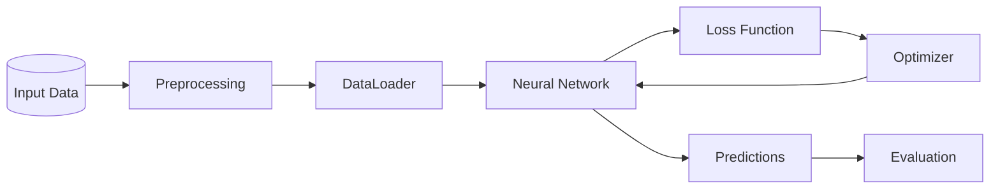

# Vision Transformer Classifier

> Vision Transformer (ViT) implementation for image classification with patch embedding, multi-head attention, and transfer learning from pretrained weights.


## Overview

**Vision Transformer Classifier** is a expert-level deep learning project focused on vision transformers.
Vision Transformer (ViT) implementation for image classification with patch embedding, multi-head attention, and transfer learning from pretrained weights.

## Problem

Complex neural architectures require careful implementation and training strategies. This project demonstrates best practices for deep learning model development.

## Solution

This project implements a modular, well-tested solution using Python, PyTorch, TorchVision. The architecture follows separation of concerns with clear interfaces between components.

## Architecture



## Features

- **Modular Architecture**: Clean separation of concerns with reusable components
- **Vision Transformers Implementation**: Core functionality with real processing logic
- **Configuration Management**: Environment-based configuration with sensible defaults
- **Error Handling**: Comprehensive error handling and logging
- **Type Hints**: Full Python type annotations throughout

## Tech Stack

- **Python**
- **PyTorch**
- **TorchVision**
- **PIL**
- **NumPy**

## Project Structure

```
vision-transformer-classifier/
├── main.py              # Entry point
├── src/
│   ├── __init__.py      # Package init
│   ├── core.py          # Core logic
│   ├── utils.py         # Utilities
│   └── config.py        # Configuration
├── tests/
│   └── test_core.py     # Unit tests
├── requirements.txt     # Dependencies
├── .gitignore           # Git ignore
└── README.md            # Documentation
```

## Installation

```bash
# Clone the repository
git clone https://github.com/YOUR_USERNAME/vision-transformer-classifier.git
cd vision-transformer-classifier

# Create virtual environment
python -m venv venv
source venv/bin/activate  # On Windows: venv\Scripts\activate

# Install dependencies
pip install -r requirements.txt
```

## Environment Variables

No environment variables required for basic functionality.

## Usage

```bash
python main.py
```

## Example Output

```
Initializing vision-transformer-classifier...
Processing complete.
Results saved to output/
```

## Limitations

- This is a demonstration project for educational purposes
- Some features may require API keys to be configured
- Performance may vary based on hardware and data size

## Future Improvements

- Add comprehensive unit and integration tests
- Implement logging and monitoring
- Add Docker support for containerized deployment
- Create CI/CD pipeline with GitHub Actions
- Add MLflow experiment tracking
- Implement model versioning

## License

MIT License
